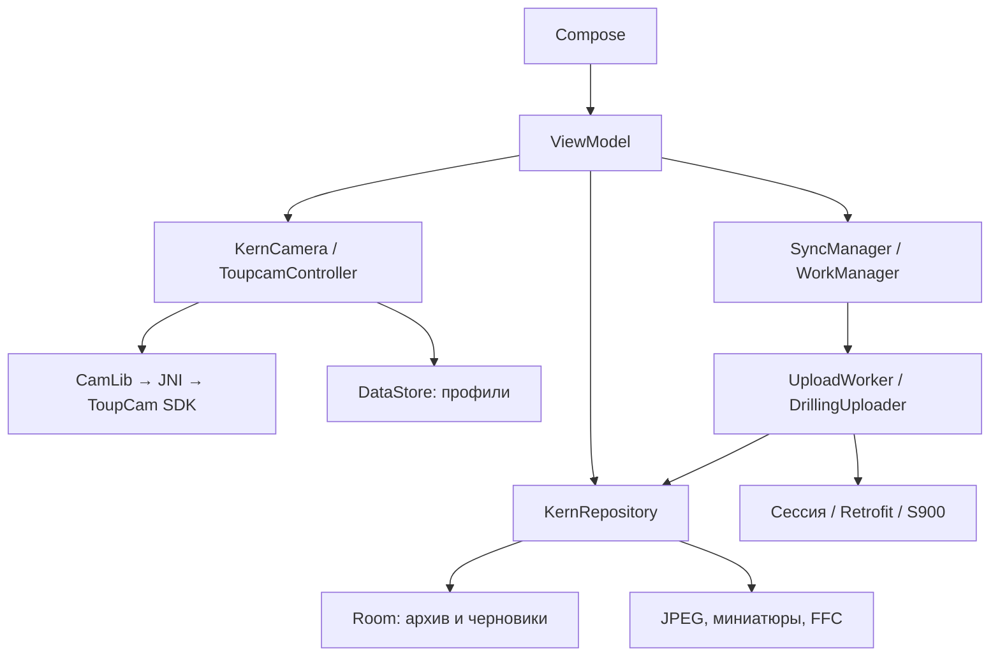

# Архитектура и данные

[← README](../README.md) · [Сценарии](WORKFLOWS.md) · [Ограничения](STATUS.md)

Сверено с кодом 2026-10-05. Основной пакет:
`app/src/main/java/com/siams/kern_prototype`.

## Компоненты

| Каталог | Ответственность |
|---|---|
| domain/model | Профили, освещение, паспорт, статусы, назначение S900 |
| data | KernRepository, PassportCodec, DepthInput |
| data/db | Room, DAO, миграции, DatabaseBackup, DatabaseGate |
| data/settings | Настройки сервера, секреты, профили, перенос профилей |
| data/storage | Файлы, миниатюры, проверка JPEG |
| camera | USB, жизненный цикл, параметры, снимок, FFC, аудит |
| viewmodel | Состояние экранов, Autosaver, CameraScreenSession |
| network, sync | HTTP, сессии, очередь, назначение и отправка |
| ui, di | Экраны, навигация, тема и внедрение зависимостей |

## Домен и хранилище

Долбление (Drilling) содержит паспорт и столы (Table). У стола — слои (Layer)
DAYLIGHT и UF; во время работы допустим один слой. Слой хранит пути JPEG/миниатюры,
глубины, данные отправки, SHA-256 и JSON аудита.
На S900 это AnalysisSource → FieldOfView → SourceImage; stackUid связывает слои.

Room — источник состояния архива и черновиков. Профили и настройки сервера —
DataStore; изображения — внутренние файлы приложения.
БД `kern.db`, версия **7**; схемы — [app/schemas](../app/schemas).

| Миграция | Добавлено |
|---|---|
| 3→4 | Подтверждение метаданных, прежний серверный ID, ревизия правок |
| 4→5 | Назначение S900, SHA-256 |
| 5→6 | Аудит снимка |
| 6→7 | form_draft: ключ, JSON полей, время |

DatabaseBackup читает версию SQLite с учётом WAL, перед обновлением делает копию
в filesDir/db_backup. Неподдерживаемые версии не открываются через удаление данных.
DatabaseGate сериализует открытие, выполняет миграции и проверку схемы,
кеширует результат до перезапуска процесса. При отказе AppRoot показывает
независимый от БД экран; стартовая сверка отправок пропускается, воркер возвращает retry.
Зависимости БД создаются лениво. Обработчики повреждения не удаляют файлы БД.

## Камера и запись снимка

Основная реализация KernCamera — ToupcamController; выбор в di/CameraModule.
Camera2 — запасная реализация, переключателя в настройках нет.

Touptek открывается через `Toupcam_Open("fd-…;wb=rgb")`: режим RGB Gain нужен
для используемых `WhiteBalanceGain` и `AwbInit`. Без суффикса SDK по умолчанию
выбирает Temp/Tint, несовместимый с этими вызовами. `TOUPCAM_OPTION_RGB` выбирает
формат пикселей, а `TOUPCAM_OPTION_WBGAIN` включает коррекцию — это не выбор режима WB.
Если с суффиксом `Toupcam_Open` вернул NULL, JNI один раз открывает камеру без него
(`jni/wb_open.h`); другие ошибки, в том числе отказы WB, повторного открытия не вызывают.
Способ открытия WB (`WbOpenMethod`) берётся при каждом открытии, сбрасывается при закрытии,
пишется в журнал и аудит снимка; резервное открытие показывается на экранах съёмки и профилей.
Это признак запроса режима, а не подтверждение работы WB.
Подробности и аппаратная проверка — [TOUPTEK_WB](TOUPTEK_WB.md).

CameraConnection владеет подключением и очередью SDK. CameraScreenSession управляет
поверхностью. StillGate отделяет ожидаемый снимок от запоздавших событий.
Замки и обработка отмены защищают единственное владение ресурсом.

Путь снимка:

1. Проверить возможность записи и глубины стола.
2. Применить профиль, дождаться двух кадров превью после применения.
3. Запросить полный кадр, дождаться события снимка.
4. Применить FFC при наличии, записать JPEG, проверить файл и подготовить метаданные.
5. Зафиксировать слой; при неудаче убрать новые файлы и сохранить прежний слой.

Ожидание превью: 2 с + 3 × большая из новой и последней известной прежней выдержки,
предел 60 с. Ошибка или отключение текущего подключения (событие этого подключения,
закрытие) прерывают ожидание превью сразу, Snap не вызывается; восстановление — штатное,
переподключением перед следующим снимком. Ожидание снимка: базовые 15 с + 3 × выдержка, предел 120 с.
При отклонении управления выдержкой используются верхние пределы.
Это запас ожидания, а не измеренная модель сенсора.

Отказы сеттеров сохраняются в отчёте применения и показываются оператору;
съёмка только из-за отрицательного HRESULT сеттера не блокируется.
AE/AWB строже: отказ обязательного вызова (ограничения и включение/выключение AE,
в том числе выключение AE при завершающем применении профиля AE и AWB, запуск AWB)
или чтения результата прекращает процедуру — сообщение с вызовом и HRESULT,
профиль не заменяется. Результат берётся только из успешных чтений `readState` до повторной
записи сеттерами; отдельные геттеры JNI при отказе подставляют значения и не используются.
Диагностические чтения (Temp/Tint и др.) процедуру не прерывают. Возврат ручного режима
после прерывания оценивается по HRESULT: отказ выключения AE — «ручной режим не подтверждён».
Успешные вызовы не доказывают сходимость AE или правильность цвета.

HUD показывает профиль. captureAuditJson содержит запрос, отчёт применения,
границы и readback SDK; readback не доказывает параметры конкретного кадра.

Превью вписывается без растяжения. Сохранение TextureView при смене компоновки
и подключение новой поверхности после пересоздания Activity — разные защиты.
JNI и подключение описаны в [TOUPCAM_SETUP](../TOUPCAM_SETUP.md).

## Паспорт, глубины и черновики

PassportCodec проверяет числа, строки сохраняет буквально (включая 0012).
Сохранённые числа показываются без экспоненты.
DepthInput проверяет неотрицательность и строгое возрастание границ.

Глубины общие логически, но физически лежат на слоях. Для каждой границы приоритет
DAYLIGHT, затем UF. Запись общих глубин обновляет слои транзакционно; новый слой
наследует проверенную пару. Старые расхождения при отправке автоматически не лечатся.

Autosaver выполняет записи последовательно, объединяя накопившиеся изменения
до последнего состояния. flush различает успех, ошибку и таймаут.
Неверный ввод хранится в form_draft. Запись данных и удаление их черновика атомарны.

## S900 и секреты

Контракт: network/S900Api.kt; порядок: sync/DrillingUploader.kt.
База API: /s8/api/v3/s8/. Вход: POST формы /s8/sia/auth/login, далее сессионная cookie,
не Basic. Положительный критерий авторизации и прав остаётся Q10.

Источник создаётся POST, существующий паспорт обновляется PUT. Первый слой
создаёт FoV, второй направляется в тот же FoV; метаданные идут отдельным PUT.
Некоторые ответы пустые или содержат строку, а не JSON.

Запросы закреплены за сервером и логином; удалённые ID не должны переноситься
на другое назначение. Перед отправкой проверяются файлы.
SHA-256 обнаруживает изменение после фиксации суммы, но не заменяет проверку JPEG.

Статусы: NOT_SENT, SENDING, SENT, ERROR. Ревизия правок и сверка зависших отправок
защищают локальное состояние; R04/R06 и финализация на сервере остаются открытыми.

Пароль шифруется AES-GCM ключом Android Keystore, лежит отдельно в kern_secrets
и связан с назначением. Общие настройки содержат признак ожидаемого пароля.
Недоступный секрет требует повторного ввода. Файл секретов исключён из backup
и переноса; политика резервирования всего архива отдельно ожидает Q14.
